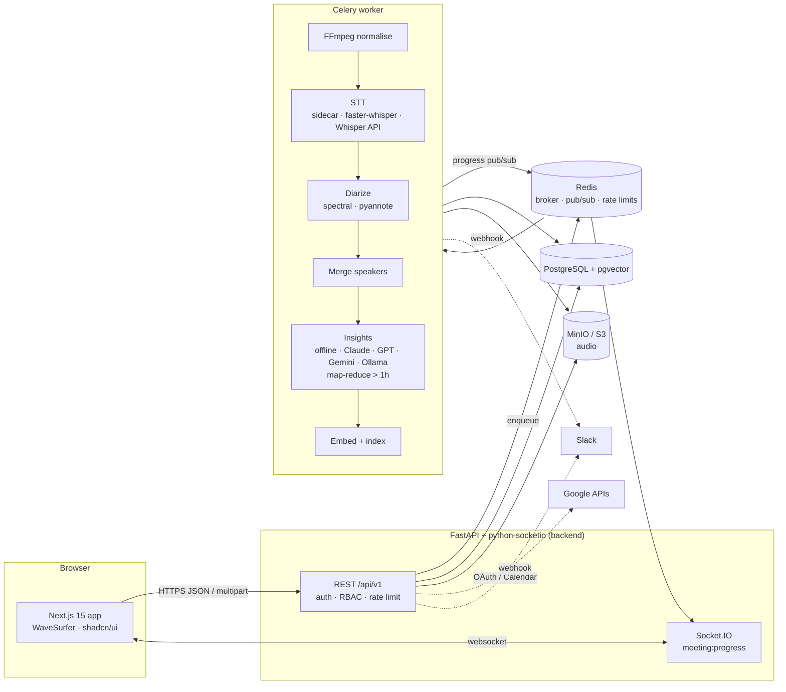

# MeetMind — AI Meeting Transcriber, Summarizer & Action-Item Tracker

MeetMind records or ingests meetings, transcribes them with speaker labels, and turns them into an
executive summary, key decisions, action items (owner + due date), open questions and per-speaker
sentiment. Action items flow onto a Kanban board, and "Ask your meetings" answers questions across
every past meeting with timestamped citations that jump straight to the moment in the audio.

Everything runs locally with **zero API keys**: speech-to-text, diarization, summarisation and
embeddings all have deterministic offline backends, and Whisper / pyannote / Claude / GPT / Gemini /
Ollama are drop-in replacements selected by environment variables.

## Features

- **Capture** — upload audio/video (WAV, MP3, M4A, WebM, MP4, MOV, …) or record in the browser (MediaRecorder); optional transcript sidecar (VTT/SRT/JSON/TXT).
- **Background pipeline** — FFmpeg normalise → transcribe → diarize → merge into a speaker-labelled, timestamped transcript → summarise → index; progress streamed live over Socket.IO (with polling fallback).
- **Transcript viewer** — WaveSurfer.js waveform (server-precomputed peaks), click any sentence to seek, active sentence follows playback, rename speakers (propagates to tasks, notes and search).
- **AI notes** — executive summary, key points, decisions, action items with owners and resolved due dates ("next Friday" → ISO date), open questions, sentiment + talk time per speaker; structured outputs validated by Pydantic.
- **Task board** — Kanban (drag-and-drop or keyboard-accessible status select), edit, assign to workspace members, due/overdue badges, deep links back to the source moment.
- **Ask your meetings** — RAG over pgvector with timestamped citations.
- **Long meetings** — map-reduce summarisation for recordings over 1 hour.
- **Sharing** — expiring, revocable public share links; Markdown and PDF export; post to Slack (Block Kit, auto-post option).
- **Team workspaces** — viewer / member / admin / owner roles, workspace switcher, tenant isolation.
- **Usage dashboard** — minutes transcribed, processing time per stage, real-time factor, actual cost and a hosted-API cost projection.
- **Integrations** — Google OAuth sign-in + Google Calendar import of upcoming meetings, Slack incoming webhooks.
- **Production hygiene** — JWT + rotating refresh tokens with reuse detection, rate limiting, structured logs with redaction, security headers, global error handling, OpenAPI docs, health checks, crash-safe pipeline (atomic claims + stale-job recovery).

## Architecture



## Tech stack

| Layer | Technology |
|---|---|
| Frontend | Next.js 15 (App Router), React 19, TypeScript, Tailwind CSS v4, shadcn/ui-style Radix components, WaveSurfer.js 8, Socket.IO client, Recharts, next-themes, Sonner |
| Backend | Python 3.12, FastAPI, SQLAlchemy 2, Alembic, Pydantic v2, python-socketio, Celery + Redis, structlog |
| AI / ML | faster-whisper (optional), pyannote.audio (optional), offline spectral diarizer (NumPy), Anthropic SDK (`claude-opus-5-5`), OpenAI SDK, Gemini & Ollama REST, pgvector |
| Storage | PostgreSQL 16 + pgvector (HNSW), MinIO/S3, Redis |
| Media | FFmpeg (in the backend image) |
| Auth | JWT access tokens + rotating httpOnly refresh cookie, Google OAuth 2.0 |
| Testing | pytest (+ moto, httpx2 MockTransport), Vitest + Testing Library, Playwright |
| DevOps | Docker multi-stage images (non-root), Docker Compose (optional GPU), GitHub Actions |

## Screenshots

> _Placeholders — add screenshots of: meetings list, meeting detail (waveform + transcript), AI notes, task board, Ask chat, usage dashboard (light & dark)._

| Meeting detail | Task board | Ask your meetings | Usage |
|---|---|---|---|
| `docs/screenshots/meeting.png` | `docs/screenshots/board.png` | `docs/screenshots/ask.png` | `docs/screenshots/usage.png` |

## Local setup

Prerequisites: Docker Desktop. For development without Docker: Python 3.12 + [uv](https://docs.astral.sh/uv/), Node 24.

```bash
cp .env.example .env          # optional — every value has a working default
docker compose up -d --build  # postgres, redis, minio, backend, worker, frontend
open http://localhost:20700   # sign in as demo@meetmind.dev / meetmind-demo
./scripts/smoke.sh            # scripted end-to-end check of every feature against the stack
```

The backend runs migrations on start and (with `SEED_DEMO=true`) seeds a demo workspace with three
processed meetings, a scheduled calendar meeting, tasks in every column and three users
(`demo@`, `alex@` member, `viewer@` viewer — all with password `meetmind-demo`).

| Service | URL |
|---|---|
| Web app | http://localhost:20700 |
| API + Swagger | http://localhost:20701/docs (ReDoc: `/redoc`) |
| Health | http://localhost:20701/health |
| MinIO console | http://localhost:20713 |
| Postgres / Redis | `localhost:20710` / `localhost:20711` |

### Development without Docker

```bash
# backend (SQLite + local storage + inline pipeline)
cd backend && uv sync -p 3.12
TASK_ALWAYS_EAGER=true STORAGE_BACKEND=local uv run alembic upgrade head
TASK_ALWAYS_EAGER=true STORAGE_BACKEND=local SEED_DEMO=true uv run python -m app.seed
TASK_ALWAYS_EAGER=true STORAGE_BACKEND=local uv run uvicorn app.main:app --port 20701 --reload

# frontend
cd frontend && npm ci && npm run dev   # http://localhost:20700
```

### Tests

```bash
cd backend  && uv run ruff check app tests && uv run mypy app && uv run pytest --cov=app
cd frontend && npm run lint && npm run typecheck && npm test && npm run build
cd frontend && npx playwright test          # against the running compose stack
python ml/scripts/eval_diarization.py       # DER of the offline diarizer (run with backend venv)
```

### Real speech models (optional)

```bash
INSTALL_ML=true STT_BACKEND=faster_whisper WHISPER_MODEL_SIZE=small \
DIARIZER_BACKEND=pyannote HF_TOKEN=hf_… docker compose up -d --build
```
Uncomment the `deploy.resources` block on the `worker` service to use an NVIDIA GPU.

## Environment variables

All variables are documented in [`.env.example`](.env.example). The most important:

| Variable | Default | Purpose |
|---|---|---|
| `JWT_SECRET` | dev value | Signing key (≥ 32 chars; required in production) |
| `DATABASE_URL` | compose Postgres | SQLAlchemy URL (`postgresql+psycopg://…` or SQLite) |
| `REDIS_URL` | compose Redis | Celery broker, Socket.IO pub/sub, rate-limit counters |
| `STORAGE_BACKEND` | `s3` (compose) | `s3` (MinIO/AWS) or `local` |
| `STT_BACKEND` | `sidecar` | `sidecar`, `faster_whisper`, `openai_whisper` |
| `DIARIZER_BACKEND` | `spectral` | `spectral` or `pyannote` (needs `HF_TOKEN`) |
| `LLM_PROVIDER` | `offline` | `offline`, `anthropic`, `openai`, `gemini`, `ollama` |
| `ANTHROPIC_API_KEY` / `ANTHROPIC_MODEL` | — / `claude-opus-5-5` | Claude configuration |
| `OPENAI_API_KEY`, `GEMINI_API_KEY`, `OLLAMA_BASE_URL` | — | Other providers |
| `LLM_FALLBACK_OFFLINE` | `true` | Degrade to offline notes if the provider fails |
| `EMBEDDING_BACKEND` | `hashing` | `hashing` or `openai` |
| `LONG_MEETING_THRESHOLD_S` | `3600` | Map-reduce summarisation threshold |
| `GOOGLE_CLIENT_ID` / `GOOGLE_CLIENT_SECRET` | — | Enables Google sign-in + Calendar import |
| `CORS_ORIGINS` | `http://localhost:20700` | Comma-separated allow-list |
| `RATE_LIMIT_*` | 240 / 20 / 20 per min | Default, auth and upload limits |
| `PIPELINE_STALE_AFTER_S` | `3600` | Re-queue jobs whose worker died |
| `SEED_DEMO` | `true` (compose) | Seed demo data on first start |

## API docs

Interactive OpenAPI docs are served at **http://localhost:20701/docs**. Highlights:

| Endpoint | Description |
|---|---|
| `POST /api/v1/auth/register`, `/login`, `/refresh`, `/logout`, `GET /me` | JWT auth with rotating refresh cookie |
| `GET /api/v1/auth/google/authorize` | Google OAuth (sign-in + Calendar scope) |
| `GET/POST /api/v1/workspaces`, `…/{id}/members` | Workspaces and RBAC |
| `POST /api/v1/workspaces/{id}/meetings` | Upload audio/video (+ optional transcript) |
| `GET /api/v1/meetings/{id}`, `/transcript`, `/progress`, `/audio?token=` | Meeting, transcript, progress, Range-enabled audio |
| `PATCH /api/v1/meetings/{id}/speakers/{speaker_id}` | Rename a speaker |
| `GET /api/v1/meetings/{id}/export?format=md\|pdf` | Export notes |
| `POST/DELETE /api/v1/meetings/{id}/share`, `GET /api/v1/share/{token}` | Share links |
| `POST /api/v1/meetings/{id}/slack` | Post summary to Slack |
| `GET/POST /api/v1/workspaces/{id}/action-items`, `PATCH /api/v1/action-items/{id}` | Task board |
| `POST /api/v1/workspaces/{id}/ask`, `GET …/search` | RAG chat and semantic search |
| `GET /api/v1/workspaces/{id}/usage` | Usage dashboard |
| `POST /api/v1/workspaces/{id}/integrations/google-calendar/import` | Calendar import |
| Socket.IO `/socket.io` → `subscribe {meeting_id \| workspace_id}` | `meeting:progress` events |

## Deployment guide

1. **Images** — `backend/Dockerfile` (API and worker share one image; `command: api|worker`) and `frontend/Dockerfile` (Next.js standalone). Both run as non-root with health checks. Build the frontend with `--build-arg NEXT_PUBLIC_API_URL=https://api.example.com`.
2. **Managed services** — PostgreSQL 16 with the `vector` extension (RDS, Cloud SQL, Neon, Supabase), Redis (ElastiCache/Upstash), S3 (or any S3-compatible store). Point `DATABASE_URL`, `REDIS_URL`, `S3_*` at them.
3. **Configuration** — set `ENVIRONMENT=production`, a strong `JWT_SECRET`, `REFRESH_COOKIE_SECURE=true`, `CORS_ORIGINS`/`FRONTEND_URL`/`PUBLIC_API_URL` to your domains, and the chosen AI backend keys. The API refuses to boot with missing/unsafe config.
4. **Run** — API: `docker run … backend api` (runs `alembic upgrade head` on start); workers: `docker run … backend worker` (scale horizontally; Socket.IO progress fans out through Redis); frontend: `docker run … frontend`. Put the API behind a TLS-terminating load balancer with WebSocket support.
5. **GPU workers** — build with `INSTALL_ML=true` and run workers on GPU nodes with `STT_BACKEND=faster_whisper`, `WHISPER_DEVICE=cuda`, `DIARIZER_BACKEND=pyannote`.
6. **CI/CD** — `.github/workflows/ci.yml` lints, type-checks and tests backend and frontend, runs migrations + seed on Postgres/pgvector, builds all images, boots the stack, runs `scripts/smoke.sh` and the Playwright suite.

## What I learned / key engineering decisions

Details in [`docs/DECISIONS.md`](docs/DECISIONS.md). In short:

- **Offline-first, pluggable AI.** Every model sits behind a tiny protocol, so the whole product — including CI and the e2e suite — runs without keys or downloads, and real models are a config change. The offline engines double as regression baselines for the LLM path.
- **A diarizer you can measure.** A NumPy spectral diarizer (VAD → log-mel + F0 → average-linkage clustering) reaches 1.65 % DER on the demo meeting at 0.003× real time. Keeping pitch on an absolute scale fixed a bug where z-scoring merged speakers in 4-person meetings — found by an edge-case test, fixed at the root.
- **Exactly-once-ish pipelines.** An atomic conditional `UPDATE` claims a meeting, a run id guards every write, and heartbeats + stale-job recovery make duplicate deliveries and worker crashes harmless.
- **Structured outputs over prompt hope.** LLM output is schema-constrained and Pydantic-validated with a single repair retry; malformed items are dropped individually; provider failures degrade to offline notes instead of failing the meeting.
- **Untrusted transcripts.** Meeting audio is user-controlled text: it is fenced and neutralised before reaching the LLM, and escaped before reaching Slack.
- **Security defaults.** Rotating refresh tokens with reuse detection, meeting-bound media tokens for `<audio>`, 404-not-403 tenant isolation, expiring share links, Redis-backed rate limits, CSP/security headers and log redaction.
